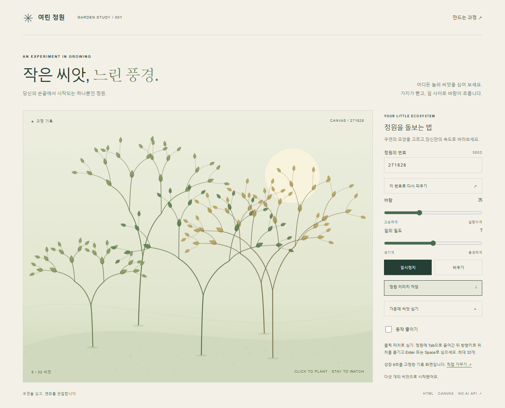

# 여린 정원

씨앗을 심고 바람·잎 밀도·정원의 번호(seed)를 조절하는 Canvas 2D 작품입니다. HTML, CSS, 일반 JavaScript로 만들어 앱 실행에 패키지 설치나 API 키가 필요하지 않습니다. AI가 구현·실행·비교한 **v0 → v1 → v2 두 차례 실제 개선**을 원본 화면과 시험 기록으로 남겼습니다. 사람의 미적 만족은 아직 확인 대기입니다.



## 바로 실행

폴더 안의 [index.html](index.html)을 브라우저에서 직접 여세요. [process.html](process.html)은 8단계 제작 과정과 세 버전 비교 보드입니다.

Python이 있다면 이 폴더에서 다음 명령으로 로컬 서버를 열 수도 있습니다.

```powershell
python -m http.server 8000
```

브라우저에서 `http://localhost:8000/` 또는 `http://localhost:8000/process.html`을 엽니다. 종료는 터미널에서 `Ctrl+C`입니다. 앱은 서버 없이도 실행되며, 수록된 자동 브라우저 시험은 `file://`에서 수행했습니다.

## 정원 가꾸기

- 정원을 클릭·터치하면 씨앗을 심습니다. 최대 32개입니다.
- Tab으로 정원에 들어가 방향키로 위치를 옮기고 Enter 또는 Space로 심습니다. ‘가운데 씨앗 심기’ 버튼도 있습니다.
- 번호를 바꾸고 ‘이 번호로 다시 피우기’를 누르면 새 정원이 됩니다. 바람과 잎 밀도도 조절할 수 있습니다.
- 일시정지·재개, 비우기, 현재 Canvas를 PNG로 저장하는 기능이 있습니다.
- 시스템의 동작 줄이기 설정과 화면의 체크박스는 성장을 즉시 완성하고 흔들림을 멈춥니다.

## 코드 내려받기

비공개 [GitHub 저장소](https://github.com/ixr-lab/vibe-coding-pipeline-garden)에 업로드했습니다. 2026-10-17 UTC에 private 상태, 원격 v0/v1/v2 태그, v2 커밋과 주요 파일8개의 바이트 일치를 다시 읽어 확인했습니다. [원격 검증 기록](evidence/remote-initial.json)과 [전달·증거 색인](docs/delivery.md)을 참고하세요. 공개 배포는 하지 않았습니다.

저장소 접근 권한과 Git이 있다면 터미널에서 다음을 실행하세요.

```powershell
git clone https://github.com/ixr-lab/vibe-coding-pipeline-garden.git
cd vibe-coding-pipeline-garden
```

그다음 `index.html`을 여세요. Git이 없다면 전달받은 ZIP을 풀어 같은 파일을 열면 됩니다. 버전은 `v0`, `v1`, `v2` 태그로 구분하며, 과거 버전 실행 방법은 [재현 지침](docs/reproduce.md)에 있습니다.

## 실제 개선과 확인 범위

| 버전 | 실제 변경·관찰 | 근거 |
| --- | --- | --- |
| v0 | 심기·정지·초기화·PNG 저장이 동작하는 최소 구현. 비등방 배율과 원형 잎으로 형태가 도식처럼 보이고 수관이 잘림 | [v0 실행](evidence/v0-run.json), [원본 화면](evidence/v0-desktop.png) |
| v1 | 같은 축 배율, 곡선 가지, 방향성 잎, 지면·질감으로 렌더 개선. AI가 원본 화면을 비교해 채택 | [v1 실행](evidence/v1-run.json), [원본 화면](evidence/v1-desktop.png) |
| v2 | 키보드 심기, 동작 줄이기, 정지 중 RAF 취소, 배경 캐시, 모바일 제어 개선. 픽셀 재현 결함도 수정 | [v2 실행](evidence/v2-run.json), [접근·모션 감사](evidence/v2-accessibility.json), [통합 시험](evidence/final-checks.json) |

저장된 증거는 Node 시험 4개와 Chrome/Chromium 브라우저 검사 26개 통과를 기록합니다. 모바일은 390×844 뷰포트·터치 에뮬레이션이며 실기기, Firefox, Safari, 스크린리더는 미검증입니다. 성능은 한 Windows 환경의 RAF 간격 측정으로, 기기 전체의 속도나 접근성 준수를 보증하지 않습니다. 상세 범위와 실패 이력은 [시험 기록](docs/tests.md)을 보세요. 재실행 시 결과·시각·성능 수치가 바뀔 수 있으므로 **최신 JSON 원본이 문서 요약보다 우선**합니다.

## 문서와 파일

| 문서 | 내용 |
| --- | --- |
| [비교 보드](process.html) | 8단계와 v0/v1/v2 화면 비교 |
| [요구·평가 기준](docs/requirements.md) / [구현 계획](docs/plan.md) | 구현 전 정한 범위와 비교 조건 |
| [레퍼런스](docs/references.md) | 실제 조회한 공식 자료와 적용 판단 |
| [실험](docs/experiments.md) / [작업 로그](docs/log.md) | 가설, 실제 관찰, 채택 판단 |
| [시험](docs/tests.md) / [재현](docs/reproduce.md) | 통과 항목, 한계, 개발용 실행법 |
| [AI와 사람의 경계](docs/ai-boundary.md) / [변경 기록](CHANGELOG.md) | 판단 책임과 버전별 변경 |
| [전달·증거 색인](docs/delivery.md) | 검증된 GitHub 링크, 버전 SHA와 단계별 증거 |

`engine.js`는 결정론적 식물 데이터와 배치, `garden.js`는 Canvas·입력·성장 상태를 담당합니다. `scripts/`와 `tests/`는 개발용이며 `evidence/`는 실제 실행의 PNG·JSON·텍스트 기록입니다.
