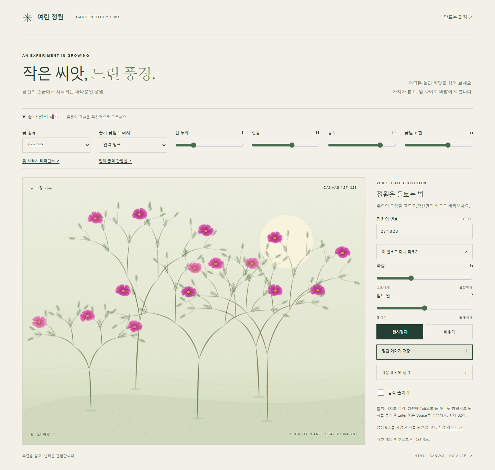
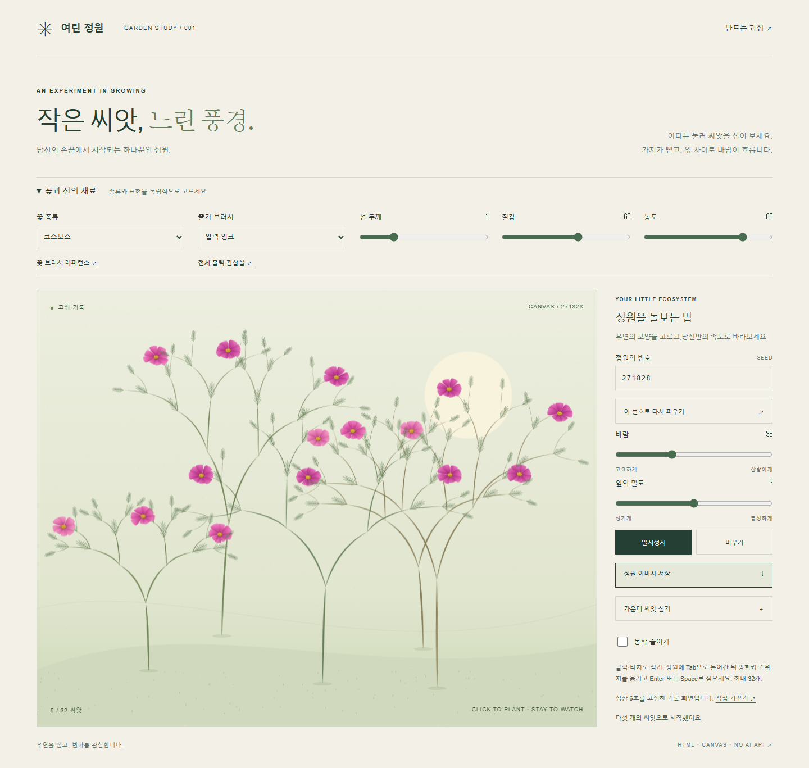
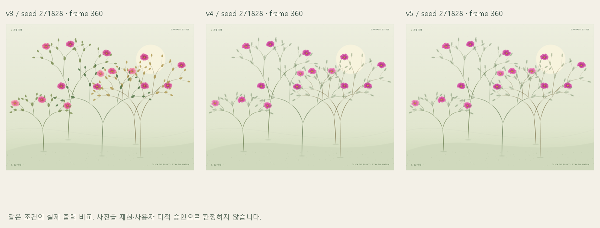

# 여린 정원

씨앗을 심고 바람·잎 밀도·정원의 번호(seed)를 조절하는 Canvas 2D 작품입니다. HTML, CSS, 일반 JavaScript로 만들어 앱 실행에 패키지 설치나 API 키가 필요하지 않습니다. 현재 **v11은 다섯 브러시를 꽃잎에도 적용**합니다. 최초 v0→v1→v2, 꽃·줄기 확장 v3→v4→v5, 꽃잎 확장 v6→v11의 실제 화면·실패·개선 기록을 보존합니다. 사용자의 직접 미적 승인과 최종 만족은 확인 대기입니다.



## 꽃잎 브러시 v11

꽃 3종(코스모스·데이지·개양귀비)의 실루엣과 겹침을 유지하면서 균일 펜·압력 잉크·연필·드라이·수채의 방향성 획을 꽃잎 안에 그립니다. 두께·질감·농도·꽃잎 표현 강도를 조절할 수 있습니다. [꽃잎 관찰실](petal-study.html)에서 같은 기하·seed의 확대/기본 크기 15조합을 비교하고, [레퍼런스 보드](reference.html)에서 실물 사진과 공식 회화의 관찰 근거를 볼 수 있습니다.

v5에서는 꽃머리가 브러시를 바꿔도 같았습니다. v6 첫 적용 뒤 v7~v10에서 금속 주름·박편·반복선·큰 색필름을 줄였고, v11은 좁은 꽃잎의 폭 상한 때문에 사라지던 드라이 접촉과 종이 빈틈을 조정했습니다. [확대 표본](evidence/petals/v11-large.png), [기본 크기](evidence/petals/v11-basic.png), [정원 안 원배율 표본](evidence/petals/v11-in-garden.png)을 함께 보세요. 변경별 의도·관찰·채택 판단은 [비교 기록](docs/petals/comparison.md)과 [작업 로그](docs/petals/log.md)에 있습니다.

AI 제작자와 독립 리뷰어의 v11 판정은 P1/P2/P4/P5/P6 충족, 재료별 세부 충실도 P3 부분충족입니다. 펜·먹·연필·드라이는 채택했으며 수채는 디지털 그라데이션 인상이 남아 부분 채택입니다. 데이지의 차이는 다른 종보다 약하고, 약 11px의 작은 꽃에서는 미세한 결이 줄어듭니다. 실제 화구의 물리나 사진을 완벽히 재현하지 않습니다. **현재 공개 전 검증 중**이며, 시각 검토의 조건부 공개 추천과 실제 공개·업로드 완료는 별개입니다.

[꽃잎 시험과 한계](docs/petals/tests.md) · [재현 지침](docs/petals/reproduce.md) · [후속 8단계](docs/petals/eight-stages.md)

## 이전 꽃과 선 확장 v3~v5

꽃 3종(코스모스·데이지·개양귀비)과 브러시 5종(균일 펜·압력 잉크·연필·드라이·수채)을 독립 선택합니다. 선 두께·질감·농도를 조절할 수 있습니다. [레퍼런스 보드](reference.html), [출력 관찰실](study.html), [확장 실험 로그](docs/extension/log.md)를 참고하세요. 실물 사진/공식 샘플은 관찰 근거로 링크하고, 제품에는 직접 그린 출력만 포함합니다. v0~v2와 원래 ZIP은 보존합니다.





## 바로 실행

폴더 안의 [index.html](index.html)을 브라우저에서 직접 여세요. 설치나 서버 없이 `file://`로 실행할 수 있습니다. [petal-study.html](petal-study.html)은 꽃잎 15조합 관찰실, [reference.html](reference.html)은 출처·관찰 보드, [process.html](process.html)은 8단계 제작 과정과 버전별 증거 보드입니다.

Python이 있다면 이 폴더에서 다음 명령으로 로컬 서버를 열 수도 있습니다.

```powershell
python -m http.server 8000
```

브라우저에서 `http://localhost:8000/` 또는 `http://localhost:8000/process.html`을 엽니다. 종료는 터미널에서 `Ctrl+C`입니다. 앱은 서버 없이도 실행되며, 수록된 자동 브라우저 시험은 `file://`에서 수행했습니다.

## 정원 가꾸기

- 정원을 클릭·터치하면 씨앗을 심습니다. 최대 32개입니다.
- Tab으로 정원에 들어가 방향키로 위치를 옮기고 Enter 또는 Space로 심습니다. ‘가운데 씨앗 심기’ 버튼도 있습니다.
- 번호를 바꾸고 ‘이 번호로 다시 피우기’를 누르면 새 정원이 됩니다. 바람과 잎 밀도도 조절할 수 있습니다.
- 일시정지·재개, 비우기, 현재 Canvas를 PNG로 저장하는 기능이 있습니다.
- 시스템의 동작 줄이기 설정과 화면의 체크박스는 성장을 즉시 완성하고 흔들림을 멈춥니다.

## 코드 내려받기

[GitHub 저장소](https://github.com/ixr-lab/vibe-coding-pipeline-garden)의 이전 v0~v5 private 업로드 검증 기록을 보존합니다. 2026-10-17 UTC에 private 상태, 원격 v0/v1/v2 태그, v2 커밋과 주요 파일8개의 바이트 일치를 다시 읽어 확인했습니다. [원격 검증 기록](evidence/remote-initial.json)과 [전달·증거 색인](docs/delivery.md)을 참고하세요. 현재 v11의 원격 push·정확한 바이트 대조와 공개 전 검증은 진행 중이며, 이 문서는 v11 업로드나 공개 완료를 선언하지 않습니다.

저장소 접근 권한과 Git이 있다면 터미널에서 다음을 실행하세요.

```powershell
git clone https://github.com/ixr-lab/vibe-coding-pipeline-garden.git
cd vibe-coding-pipeline-garden
```

그다음 `index.html`을 여세요. Git이 없다면 전달받은 ZIP을 풀어 같은 파일을 열면 됩니다. 최초 버전은 `v0`, `v1`, `v2` 태그로 구분하며, 과거 버전 실행 방법은 [최초 재현 지침](docs/reproduce.md)에 있습니다. 꽃잎 단계의 확인된 소스는 v6 `f2d687e`, v7 `e1aa152`, v8 `de94619`, v9 `21529f0`, v10 `3e0e494`입니다. v11은 현재 작업본으로, 확정 커밋·태그는 원격 검증 후 전달 기록을 따릅니다. [꽃잎 재현 지침](docs/petals/reproduce.md)을 참고하세요.

## 확장 검증과 한계

확장에서는 [v3→v4 꽃 개선](evidence/extension/flower-evolution.png), [v3→v5 브러시 개선](evidence/extension/brush-evolution.png), [15개 조합](evidence/extension/v5-combinations.png)을 실제 렌더로 비교했습니다. [항목별 시각 비교](docs/extension/comparison.md)와 [확장 시험 기록](docs/extension/tests.md)을 보세요. 수채의 자연스러운 구름상 안료와 종이 섬유·실제 3차원 식물 구조는 아직 미달이며 사진급 물리 재현을 주장하지 않습니다. 선택 변경은 최대 장면에서 초기 캐시 재생성 비용이 있습니다.

레퍼런스는 JSON에서 페이지와 문서를 함께 생성합니다. 후속 변경 때 [관리 지침](docs/extension/reference-maintenance.md)에 따라 `python scripts/build_references.py --check`를 실행하세요.

## 최초 v0~v2 개선과 확인 범위

| 버전 | 실제 변경·관찰 | 근거 |
| --- | --- | --- |
| v0 | 심기·정지·초기화·PNG 저장이 동작하는 최소 구현. 비등방 배율과 원형 잎으로 형태가 도식처럼 보이고 수관이 잘림 | [v0 실행](evidence/v0-run.json), [원본 화면](evidence/v0-desktop.png) |
| v1 | 같은 축 배율, 곡선 가지, 방향성 잎, 지면·질감으로 렌더 개선. AI가 원본 화면을 비교해 채택 | [v1 실행](evidence/v1-run.json), [원본 화면](evidence/v1-desktop.png) |
| v2 | 키보드 심기, 동작 줄이기, 정지 중 RAF 취소, 배경 캐시, 모바일 제어 개선. 픽셀 재현 결함도 수정 | [v2 실행](evidence/v2-run.json), [접근·모션 감사](evidence/v2-accessibility.json), [통합 시험](evidence/final-checks.json) |

저장된 증거는 Node 시험 4개와 Chrome/Chromium 브라우저 검사 26개 통과를 기록합니다. 모바일은 390×844 뷰포트·터치 에뮬레이션이며 실기기, Firefox, Safari, 스크린리더는 미검증입니다. 성능은 한 Windows 환경의 RAF 간격 측정으로, 기기 전체의 속도나 접근성 준수를 보증하지 않습니다. 상세 범위와 실패 이력은 [시험 기록](docs/tests.md)을 보세요. 재실행 시 결과·시각·성능 수치가 바뀔 수 있으므로 **최신 JSON 원본이 문서 요약보다 우선**합니다.

## 문서와 파일

| 문서 | 내용 |
| --- | --- |
| [꽃잎 관찰실](petal-study.html) / [비교 보드](process.html) | 꽃잎 15조합과 버전별 8단계 증거 |
| [꽃잎 비교](docs/petals/comparison.md) / [후속 8단계](docs/petals/eight-stages.md) | v5 기준부터 v11까지의 실제 수정과 판단 |
| [꽃잎 시험](docs/petals/tests.md) / [꽃잎 재현](docs/petals/reproduce.md) | 기능·회귀·성능의 확인 범위와 동일 조건 실행 |
| [요구·평가 기준](docs/requirements.md) / [구현 계획](docs/plan.md) | 구현 전 정한 범위와 비교 조건 |
| [레퍼런스](docs/references.md) | 실제 조회한 공식 자료와 적용 판단 |
| [실험](docs/experiments.md) / [작업 로그](docs/log.md) | 가설, 실제 관찰, 채택 판단 |
| [시험](docs/tests.md) / [재현](docs/reproduce.md) | 통과 항목, 한계, 개발용 실행법 |
| [AI와 사람의 경계](docs/ai-boundary.md) / [변경 기록](CHANGELOG.md) | 판단 책임과 버전별 변경 |
| [전달·증거 색인](docs/delivery.md) | 검증된 GitHub 링크, 버전 SHA와 단계별 증거 |

`engine.js`는 결정론적 식물 데이터와 배치, `garden.js`는 Canvas·입력·성장 상태를 담당합니다. `scripts/`와 `tests/`는 개발용이며 `evidence/`는 실제 실행의 PNG·JSON·텍스트 기록입니다.


확장 v3/v4/v5도 같은 private 저장소에 업로드하고 원격 소스·문서·시험·이미지23개 내용을 대조했습니다. [확장 전달·버전 증거](docs/extension/delivery.md)와 [원격 검증 JSON](evidence/extension/remote-v5.json)을 참고하세요. `reference.html`은 내려받은 폴더에서 열며 공개 호스팅은 하지 않았습니다.
